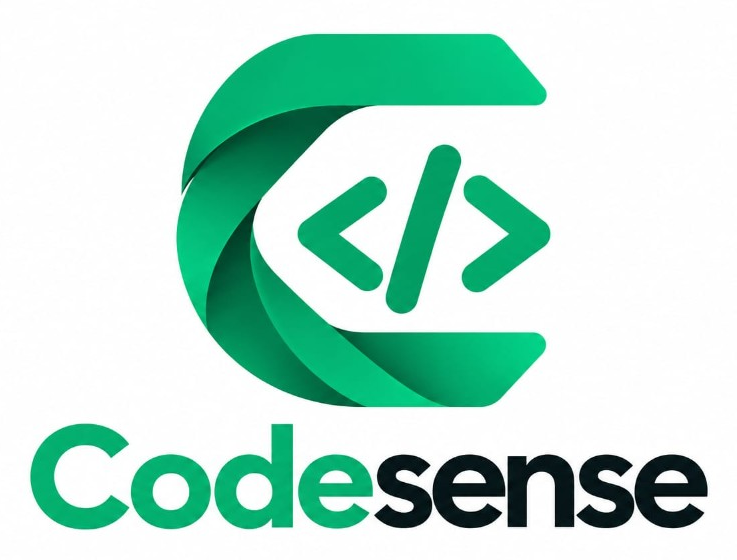

<p align="center">
  
</p>

# CodeSense

Interactive tutor that turns a lab question into pseudocode the student builds decision by decision, then later runs their Python, Java, or C program and explains that run against the plan.

**This folder’s working software is the prototype:** question to pseudocode only. No program runner, trace, narration, accounts, or sandbox yet.

## Run the prototype

You need [Java 21+](https://adoptium.net/) and [Node.js 20+](https://nodejs.org/) (or [Docker Desktop](https://www.docker.com/products/docker-desktop/)).

```bash
cd prototype/frontend
npm install
```

Then two terminals:

```bash
cd prototype/backend
mvn spring-boot:run
```

```bash
cd prototype/frontend
npm run dev
```

Open **http://127.0.0.1:43124**

Docker instead:

```bash
cd prototype
docker compose up --build
```

Details: [prototype/README.md](prototype/README.md)

The frozen installment 1 workshop lives in [installment-1/](installment-1/).

## What the prototype does

1. Paste one console-procedure question.
2. Answer the decisions one at a time: input first, then strategy, memory, and stop when something repeats, and output last. Memory and stop are skipped when nothing repeats. A wrong answer gets two more tries; the third miss shows the correct decision and why.
3. Confirm or rewrite each pseudocode line. The model writes INPUT, OUTPUT, and the rest of the plan from those decisions.
4. Solve a Parsons puzzle: the lines are shuffled, you restore order and indent, then check.

A theory, class-design, SQL, webpage, debugging, multi-procedure, or off-scope question is refused in one sentence.

## Roadmap

The prototype is installment 1: Learning Space, graded Socratic decisions, Parsons, and **Spring AI** (Ollama by default, rules fallback if no model is up). **Installment 3** is the mid-project review. **Installment 6** is the final review.

1. Workshop UI, Parsons, and bugfix — [installment-1/](installment-1/)
2. Pseudocode translator — glossary, mark trigger words, assemble the plan, then a Blockly-style path Parsons
3. Flowchart-piece puzzle — join boxes and diamonds
4. Python — convert the plan, run it in the browser (Pyodide), predict each step
5. Java track + accounts — same convert/run/predict, plus signup and saved progress
6. C track + dashboard — C in the browser, performance matrix, per-language streaks
