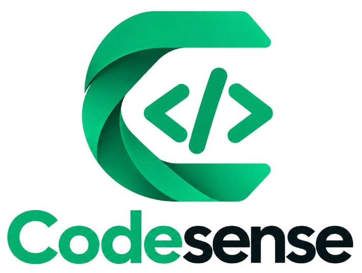

<p align="center">
  
</p>

# CodeSense

A web tutor for one console procedure at a time. A student pastes a lab question, builds the plan as decisions, restores the pseudocode order, then writes and runs **Python**, **Java**, or **C** against that plan.

Python and C run in the browser (Pyodide and JSCPP). Java compiles with `javac` on the API machine and prints in the same editor.

Guests can try a lab. Sign in from Profile.

## Run on your computer

**Needs:** [Java 21+](https://adoptium.net/), [Node.js 20+](https://nodejs.org/), and [MongoDB](https://www.mongodb.com/) (or [Docker Desktop](https://www.docker.com/products/docker-desktop/)).

```bash
cd frontend
npm install
```

Start MongoDB, then two terminals:

```bash
docker compose up -d mongo
```

```bash
cd backend
mvn spring-boot:run
```

```bash
cd frontend
npm run dev
```

Open **http://127.0.0.1:43124**

| Service | URL |
|---------|-----|
| Workshop | http://127.0.0.1:43124 |
| API | http://127.0.0.1:8090 |

### Docker

```bash
docker compose up --build
```

Same URLs. The UI is served on port 43124.

## What it does

1. Paste one console-procedure question, or sign in from Profile.
2. Answer the decisions (Socratic questions or translator cards), then restore Parsons order.
3. Write the plan as **Python**, **Java**, or **C**. Predict each step, then run.

A theory, class-design, SQL, webpage, debugging, multi-procedure, or off-scope question is refused in one sentence.

Paste `Find the largest number in a list.` to walk the happy path. Paste `Write a SQL query to list students in CS101.` to see a refusal.

**I don't know** asks a narrower question. It does not dump the finished rule.

## LLM

The API is **Spring Boot** (Java 21). Every model call goes through **Spring AI** `ChatClient`. The default local model is [Ollama](https://ollama.com) **qwen3:8b**.

If Ollama is stopped, the rule engine still runs the demo.

| Variable | Effect |
|----------|--------|
| `OLLAMA_BASE_URL` | Default `http://127.0.0.1:11434` |
| `OLLAMA_MODEL` | Default `qwen3:8b` if that model is installed |
| `GEMINI_API_KEY` | Google Gemini |
| `GROQ_API_KEY` | Groq |
| `OPENAI_API_KEY` | OpenAI-compatible API |
| `OPENAI_BASE_URL` | Default `https://api.openai.com/v1` |
| `MONGODB_URI` | Default `mongodb://127.0.0.1:27017/codesense` |

Copy `backend/.env.example` if you want a local file. Keys stay on the server.

## Tests

```bash
cd backend
mvn test
```
